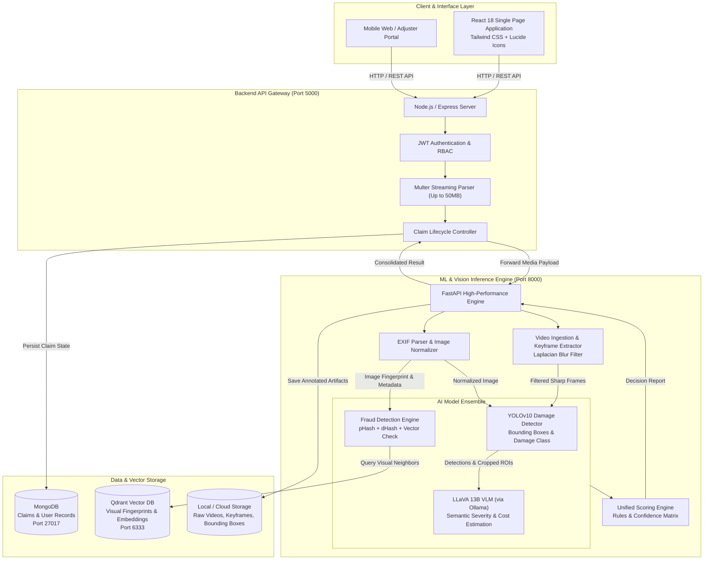
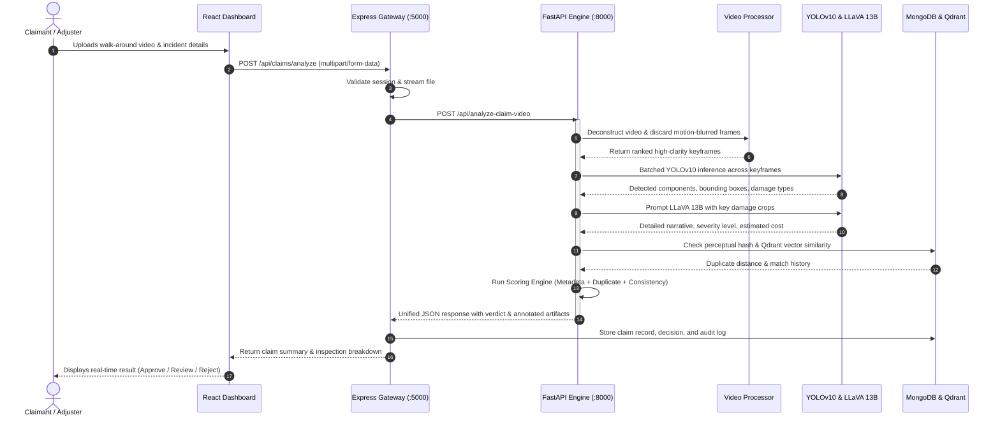

# 🚗 InsureAutoAI: Autonomous Vehicle Insurance Claim Intelligence Platform

[](https://www.python.org/)
[](https://fastapi.tiangolo.com/)
[](https://react.dev/)
[](https://nodejs.org/)
[](https://github.com/ultralytics/ultralytics)
[](https://ollama.com/library/llava)
[](https://qdrant.tech/)
[](https://www.mongodb.com/)
[](https://www.docker.com/)
[](LICENSE)

An enterprise-grade, end-to-end multimodal AI platform that automates vehicle damage claim adjudication using computer vision, walk-around video keyframe extraction, Vision-Language Models (VLMs), and multi-layer fraud detection.

---

## 📋 Table of Contents

- [Overview & Value Proposition](#-overview--value-proposition)
- [Key Features](#-key-features)
- [System Architecture](#-system-architecture)
  - [Full-Stack Architecture Diagram](#full-stack-architecture-diagram)
  - [Multimodal Video & Image Processing Pipeline](#multimodal-video--image-processing-pipeline)
  - [End-to-End Sequence Flow](#end-to-end-sequence-flow)
- [Repository Structure](#-repository-structure)
- [Core AI/ML Capabilities](#-core-aiml-capabilities)
  - [1. Walk-Around Video Keyframe Decimation & Blur Filtering](#1-walk-around-video-keyframe-decimation--blur-filtering)
  - [2. YOLOv10 Damage Detection & Localization](#2-yolov10-damage-detection--localization)
  - [3. LLaVA 13B Visual Reasoning Engine](#3-llava-13b-visual-reasoning-engine)
  - [4. Multi-Layer Fraud Detection Engine](#4-multi-layer-fraud-detection-engine)
  - [5. Automated Decision & Scoring Engine](#5-automated-decision--scoring-engine)
- [Technology Stack](#-technology-stack)
- [Prerequisites & System Requirements](#-prerequisites--system-requirements)
- [Getting Started](#-getting-started)
  - [Option 1: Docker Compose (All-in-One)](#option-1-docker-compose-all-in-one)
  - [Option 2: Local Multi-Service Development](#option-2-local-multi-service-development)
- [API Reference](#-api-reference)
  - [FastAPI ML Service (`:8000`)](#fastapi-ml-service-8000)
  - [Express Backend Gateway (`:5000`)](#express-backend-gateway-5000)
- [Environment Configuration](#-environment-configuration)
- [Troubleshooting & FAQ](#-troubleshooting--faq)
- [Contributing](#-contributing)
- [License](#-license)

---

## 🎯 Overview & Value Proposition

Traditional motor claim verification requires days of manual physical inspections, back-and-forth documentation, and manual fraud screening, leading to high administrative overhead and exposure to fraudulent claims.

**InsureAutoAI** transforms this workflow into an automated, transparent, and instantaneous process:
1. **Walk-Around Video & Photo Evidence**: Claimants record a continuous walk-around video or high-resolution photos of vehicle damage.
2. **Quality-Aware Ingestion**: OpenCV isolates the sharpest, damage-relevant frames while eliminating camera shake, blur, and lighting distortions using Laplacian variance filtering.
3. **Dual-Model Computer Vision**:
   - **YOLOv10** pinpoints exact damage classes (dents, scratches, cracks, shattered glass, structural crumpling) with bounding box coordinates.
   - **LLaVA 13B** provides deep multi-modal reasoning: severity classification, repair vs. replacement recommendations, and labor/parts cost estimations.
4. **Zero-Trust Fraud Shield**: Perceptual image hashing, EXIF metadata tampering checks, and Qdrant dense vector embeddings prevent recycled internet photos or staged repeat claims.
5. **Explainable Adjudication**: Synthesizes a transparent score resulting in instantaneous **APPROVE**, **MANUAL REVIEW**, or **REJECT** decisions.

---

## ✨ Key Features

- 🎥 **Walk-Around Video Inspection**: Seamlessly processes video files (`.mp4`, `.mov`, `.avi`, `.webm`), dynamically extracts keyframes, and aggregates multi-angle evidence into a single claim file.
- 📸 **High-Resolution Photo Adjudication**: Single- and multi-image processing with EXIF metadata parsing (GPS coordinate consistency, camera signature, timestamp cross-referencing).
- 🧠 **Dual AI Architecture**: High-speed object localization with YOLOv10 alongside semantic reasoning with LLaVA 13B.
- 🛡️ **Vector & Perceptual Fraud Prevention**:
  - Qdrant vector database similarity detection flags previously submitted vehicle photos across the entire claim history.
  - Perceptual hashing (`dhash`, `phash`, `whash`) detects modified, cropped, or filtered images.
  - EXIF temporal validation cross-references image capture timestamps with the reported incident time.
- ⚖️ **Weighted Scoring Engine**: Computes transparent confidence and fraud risk metrics with actionable breakdowns for claim adjusters.
- 📊 **Executive & Adjuster Dashboard**: Interactive React frontend with status breakdown, severity categorization, annotated bounding box visualization, and repair cost estimations.
- 🔐 **Secure Role-Based Backend**: Node.js/Express API gateway with JWT authentication, MongoDB claim history persistence, and robust multi-part streaming.

---

## 🏗️ System Architecture

### Full-Stack Architecture Diagram



---

### Multimodal Video & Image Processing Pipeline

```mermaid
flowchart LR
    A["Raw Media Input<br/>(Video / Photo)"] --> B{"Input Type?"}
    
    B -->|"Walk-Around Video"| C["Temporal Frame Decimation<br/>Extract 1 frame / sec"]
    C --> D["Laplacian Blur Filter<br/>Reject Variance < Threshold"]
    D --> E["Keyframe Quality Selection<br/>Top N Sharpest Frames"]
    
    B -->|"Static Image"| F["EXIF Extraction & Validation<br/>GPS, Device, Timestamps"]
    
    E --> G["YOLOv10 Damage Detector"]
    F --> G
    
    G --> H["Localized Bounding Boxes<br/>Dents, Scratches, Glass Cracks"]
    
    H --> I["LLaVA 13B Multi-Modal VLM"]
    I --> J["Severity & Repair Estimates"]
    
    F --> K["Perceptual Hashing & Qdrant Search"]
    K --> L["Duplicate Image & Fraud Check"]
    
    J --> M["Multi-Factor Scoring Engine"]
    L --> M
    
    M --> N{"Decision Threshold"}
    N -->|"Fraud < 3.0 & High Consistency"| O["APPROVE"]
    N -->|"Moderate Risk or Ambiguity"| P["MANUAL REVIEW"]
    N -->|"Fraud > 7.0 or Tampering"| Q["REJECT"]
```



---

### End-to-End Sequence Flow



---

## 📁 Repository Structure

```
InsureAutoAI/
├── .env.template                     # Template with environment variables for all services
├── .gitignore                        # Global ignore rules (ignoring test artifacts & model weights)
├── docker-compose.yml                # Multi-container orchestration (FastAPI, Qdrant, MongoDB)
├── README.md                         # Main repository architecture and documentation
│
├── frontend/                         # React 18 Web Application
│   ├── package.json                  # Frontend dependencies and build scripts
│   ├── tailwind.config.js            # Tailwind CSS configuration
│   ├── postcss.config.js             # PostCSS plugins
│   ├── public/                       # Static public assets, index.html, and favicons
│   └── src/
│       ├── App.js                    # Router setup (Dashboard, Claim Submission, Claim Detail)
│       ├── App.css                   # Global layout styling
│       ├── index.js                  # React DOM entry point
│       ├── components/
│       │   ├── ClaimSubmission.jsx   # Walk-around video and photo claim upload form
│       │   ├── ClaimsDashboard.jsx   # Claims overview, metrics, and filterable table
│       │   └── ClaimDetail.jsx       # In-depth claim analysis, keyframe gallery & fraud report
│       └── services/
│           └── api.js                # Axios HTTP client connecting to backend gateway
│
├── backend/                          # Node.js / Express API Gateway
│   ├── package.json                  # Express dependencies, Mongoose, Multer, JWT
│   ├── check_status.ps1              # PowerShell diagnostic utility for backend services
│   ├── test_integration.ps1          # Automated API test script
│   └── src/
│       ├── server.js                 # Express server bootstrap, DB connection & route mounting
│       ├── models/
│       │   ├── Claim.js              # Mongoose schema for persistent claims and AI verdicts
│       │   └── User.js               # Mongoose schema for user accounts and authentication
│       └── routes/
│           ├── auth.js               # User registration, login, and JWT token issuance
│           └── claims.js             # Claim submission, status retrieval, and ML proxy routing
│
└── ml-backend/                       # Python FastAPI Machine Learning & Vision Service
    ├── Dockerfile                    # Containerization specification for Python ML service
    ├── requirements.txt              # Standard CPU/development Python dependencies
    ├── requirements_gpu.txt          # GPU-accelerated dependencies (CUDA, bitsandbytes)
    ├── download_models.py            # Automated downloader for YOLO model weights
    ├── inject_metadata.py            # Utility for testing EXIF metadata injection
    ├── app/
    │   ├── __init__.py
    │   ├── main.py                   # FastAPI application initialization & route definitions
    │   ├── api/
    │   │   └── routes.py             # Extended API routers for inspection jobs
    │   ├── models/
    │   │   ├── yolo_detector.py      # Ultralytics YOLOv10 wrapper for damage localization
    │   │   ├── llava_analyzer.py     # LLaVA 13B VLM integration via Ollama
    │   │   └── fraud_detector.py     # Perceptual hash + Qdrant similarity fraud detector
    │   ├── services/
    │   │   ├── preprocessing.py      # Image normalization, resizing, and quality evaluation
    │   │   ├── video_processor.py    # Walk-around video decoder, blur rejection, keyframing
    │   │   ├── detection_service.py  # Orchestrator combining YOLO, LLaVA, and fraud checks
    │   │   ├── metadata_extractor.py # EXIF parser for GPS, timestamp, and device fingerprint
    │   │   └── scoring_engine.py     # Multi-variable weighted decision algorithm
    │   └── utils/
    │       ├── image_utils.py        # Bounding box drawing and base64 converters
    │       └── prompt_templates.py   # Structured domain prompts for LLaVA reasoning
    └── data/
        └── test_videos/              # Sample test video clips for pipeline validation
```

---

## 🔬 Core AI/ML Capabilities

### 1. Walk-Around Video Keyframe Decimation & Blur Filtering
When claimants walk around a vehicle, handheld recording inevitably introduces motion blur and redundant frames.
- **Frame Sampling**: The `VideoProcessor` captures video at calibrated intervals (e.g., 1 frame per second).
- **Laplacian Blur Rejection**: Evaluates frame sharpness via the variance of the Laplacian:
  $$\text{Var}(\nabla^2 I) < \theta_{\text{blur}}$$
  Any frame failing the sharpness threshold is immediately discarded.
- **Keyframe Ranking**: Evaluates contrast, luminance, and information entropy to prioritize the top candidate keyframes for downstream AI inference.

### 2. YOLOv10 Damage Detection & Localization
- High-throughput vehicle damage detection identifying classes such as:
  - `dent`
  - `scratch`
  - `crack` / `broken glass`
  - `bumper damage`
  - `door panel deformation`
- Generates precise normalized bounding boxes `[x1, y1, x2, y2]` along with detection confidence scores.
- Renders visual inspection overlays saved for claim adjusters.

### 3. LLaVA 13B Visual Reasoning Engine
- Uses large multimodal vision-language modeling via local Ollama inference.
- Evaluates damage severity on a structured scale: **Minor**, **Moderate**, **Severe**, or **Total Loss**.
- Validates whether the claimant's narrative matches the physical evidence (e.g., distinguishing between a slow parking scraping vs. a high-speed collision impact).
- Predicts preliminary labor operations (repair vs. panel replacement) and itemized cost ranges.

### 4. Multi-Layer Fraud Detection Engine
- **Vector Embeddings via Qdrant**: Calculates dense visual embeddings and compares them against millions of previously filed claims to catch syndicated or re-used images.
- **Perceptual Image Hashing**: Evaluates Hamming distance across Difference Hash (`dHash`) and Perceptual Hash (`pHash`) to flag cropped, tinted, or manipulated images.
- **EXIF Metadata Forensics**: Flags missing timestamps, digital manipulation software signatures (Photoshop, GIMP), or GPS coordinates inconsistent with the reported accident location.

### 5. Automated Decision & Scoring Engine
Aggregates independent risk vectors into a standardized score ($0.0$ to $10.0$):
$$\text{Score} = w_{\text{dup}} \cdot S_{\text{duplicate}} + w_{\text{meta}} \cdot S_{\text{metadata}} + w_{\text{cons}} \cdot S_{\text{inconsistency}}$$

- **Score $< 3.0$**: **APPROVE** (Low fraud risk, verified physical damage, consistent metadata).
- **Score $3.0 - 6.9$**: **MANUAL REVIEW** (Ambiguous damage or minor metadata discrepancies).
- **Score $\ge 7.0$**: **REJECT** (High probability of fraud, duplicate image match, or synthetic evidence).

---

## 🛠️ Technology Stack

| Layer | Technologies | Description |
|---|---|---|
| **Frontend** | React 18, Tailwind CSS, Lucide Icons, Axios | Responsive single-page application with real-time analysis updates |
| **Backend Gateway** | Node.js, Express, Mongoose, Multer, JWT | Secure RESTful API gateway, authentication, and file streaming |
| **ML Inference** | Python 3.10+, FastAPI, Uvicorn | Async high-performance vision processing microservice |
| **Vision Models** | Ultralytics YOLOv10, LLaVA 13B (Ollama) | Real-time object localization and multimodal visual reasoning |
| **Image & Video Ops**| OpenCV (`cv2`), Pillow, ImageHash, ExifRead | Blur filtering, frame extraction, perceptual hashing, EXIF parsing |
| **Databases** | Qdrant (Vector DB), MongoDB (Document Store) | Visual embedding search and persistent claim data storage |
| **DevOps & Containers** | Docker, Docker Compose | Reproducible multi-service deployment |

---

## 💻 Prerequisites & System Requirements

### Hardware Requirements
- **CPU**: 4 cores minimum (8+ cores recommended)
- **RAM**: 8 GB minimum (16 GB+ recommended for local LLaVA 13B execution)
- **GPU (Optional)**: NVIDIA GPU with 8GB+ VRAM (RTX 3060 / T4 or better) for GPU-accelerated inference. CPU mode is also supported.
- **Disk**: 25 GB free disk space (for Docker images and model weights)

### Software Requirements
- [Git](https://git-scm.com/)
- [Node.js](https://nodejs.org/) (v18.0 or newer) & npm
- [Python](https://www.python.org/) (v3.10 or newer)
- [Docker & Docker Compose](https://www.docker.com/)
- [Ollama](https://ollama.ai/) (for running LLaVA 13B locally)

---

## 🚀 Getting Started

### Option 1: Docker Compose (All-in-One)

The quickest method to spin up Qdrant, MongoDB, and the ML Backend:

1. **Clone the repository:**
   ```bash
   git clone https://github.com/Kamraanmulani/InsureAutoAI.git
   cd InsureAutoAI
   ```

2. **Start supporting services via Docker Compose:**
   ```bash
   docker-compose up -d
   ```
   This initiates:
   - **Qdrant Vector Database**: `http://localhost:6333`
   - **MongoDB**: `localhost:27017`
   - **ML Backend Service**: `http://localhost:8000`

3. **Verify running containers:**
   ```bash
   docker-compose ps
   ```

---

### Option 2: Local Multi-Service Development

To run each tier individually for active development:

#### 1. Setup Ollama (Vision-Language Runtime)
```bash
# Install Ollama and pull LLaVA 13B
ollama pull llava:13b

# Start the Ollama server
ollama serve
```

#### 2. Setup & Run ML Backend (FastAPI - Port 8000)
```bash
cd ml-backend

# Create and activate virtual environment
python -m venv venv
# Windows:
.\venv\Scripts\activate
# Linux/macOS:
source venv/bin/activate

# Install dependencies (CPU or GPU)
pip install -r requirements.txt
# For CUDA acceleration: pip install -r requirements_gpu.txt

# Download YOLO weights if not present
python download_models.py

# Launch FastAPI server
uvicorn app.main:app --host 0.0.0.0 --port 8000 --reload
```
Verify the ML service at `http://localhost:8000/docs` or `http://localhost:8000/health`.

#### 3. Setup & Run Backend Gateway (Node.js/Express - Port 5000)
```bash
cd ../backend

# Install npm dependencies
npm install

# Start Express in development mode
npm run dev
# Or start directly:
node src/server.js
```
The gateway will run on `http://localhost:5000`.

#### 4. Setup & Run Frontend (React - Port 3000)
```bash
cd ../frontend

# Install dependencies
npm install

# Start React development server
npm start
```
Open `http://localhost:3000` in your browser to access the InsureAutoAI interface.

---

## 📖 API Reference

### FastAPI ML Service (`:8000`)

| Method | Endpoint | Description |
|---|---|---|
| `GET` | `/health` | Health check verifying preprocessing, YOLO, LLaVA, Qdrant & scoring engines |
| `POST` | `/api/analyze-claim` | Processes single or multi-photo vehicle damage claims |
| `POST` | `/api/analyze-claim-video` | Decodes walk-around video, extracts sharp keyframes & performs aggregated damage analysis |
| `GET` | `/api/claim/{job_id}` | Retrieves full adjudication payload and score breakdown for a specific job |
| `GET` | `/api/claims` | Lists all in-memory processed claims |
| `GET` | `/api/annotated-image/{job_id}` | Serves the annotated image with YOLO bounding boxes |

#### Sample Request (`/api/analyze-claim-video`):
```bash
curl -X POST "http://localhost:8000/api/analyze-claim-video" \
  -F "video=@test_walkaround.mp4" \
  -F "claim_date=2026-10-15" \
  -F "claim_description=Vehicle sideswiped while parked in shopping lot" \
  -F "claim_location=San Francisco, CA" \
  -F "policy_id=POL-94821"
```

---

### Express Backend Gateway (`:5000`)

| Method | Endpoint | Description |
|---|---|---|
| `GET` | `/health` | Gateway status and MongoDB connection verification |
| `POST` | `/api/auth/register` | Register a new user or adjuster account |
| `POST` | `/api/auth/login` | Authenticate and obtain JWT bearer token |
| `POST` | `/api/claims/analyze` | Accepts video or photo files, streams to ML service, and records claim in MongoDB |
| `GET` | `/api/claims` | Fetch all historical claims with search, filter, and pagination |
| `GET` | `/api/claims/:id` | Fetch specific claim by Mongo database ID |
| `GET` | `/api/claims/job/:jobId` | Fetch claim by unique analysis Job ID |
| `GET` | `/api/claims/stats/dashboard` | Aggregated analytics (Total, Approved, Under Review, Rejected) |

---

## ⚙️ Environment Configuration

Refer to [.env.template](.env.template) for default settings:

```env
# ==========================================
# ML Backend Configuration (FastAPI)
# ==========================================
API_HOST=0.0.0.0
API_PORT=8000
API_RELOAD=true
LOG_LEVEL=INFO

# AI Models
YOLO_MODEL_PATH=yolov10m.pt
LLAVA_MODEL_NAME=llava:13b
OLLAMA_HOST=http://localhost:11434

# Vector DB & Storage
USE_QDRANT=true
QDRANT_HOST=localhost
QDRANT_PORT=6333
MONGODB_URI=mongodb://localhost:27017/insurance_claims

# ==========================================
# Backend API Gateway (Node.js/Express)
# ==========================================
PORT=5000
ML_API_URL=http://localhost:8000
JWT_SECRET=your_jwt_secret_key_here

# ==========================================
# Frontend Configuration (React)
# ==========================================
REACT_APP_API_URL=http://localhost:5000/api
REACT_APP_ML_API_URL=http://localhost:8000
```

---

## ❓ Troubleshooting & FAQ

### 1. Ollama fails to connect (`http://localhost:11434`)
- Confirm the Ollama daemon is running with `ollama serve`.
- Ensure the model has been downloaded using `ollama pull llava:13b`.
- Test model responsiveness with:
  ```bash
  ollama run llava:13b "Are you ready?"
  ```

### 2. Qdrant connection refused (`localhost:6333`)
- Start Qdrant with `docker-compose up -d qdrant` or via Docker:
  ```bash
  docker run -p 6333:6333 -v ${PWD}/ml-backend/data/qdrant_storage:/qdrant/storage qdrant/qdrant
  ```
- Test connectivity: `curl http://localhost:6333/health`

### 3. Out of Memory (OOM) during video processing
- Handheld 4K videos can require substantial memory during decompression.
- In `ml-backend/app/utils/video_processor.py`, adjust `max_keyframes` or increase sampling interval to process fewer frames.
- If running on CPU, you can switch from `llava:13b` to `llava:7b` in your `.env` configuration.

---

## 🤝 Contributing

We welcome community contributions to improve InsureAutoAI:

1. Fork the repository.
2. Create your feature branch: `git checkout -b feature/amazing-feature`.
3. Commit your changes: `git commit -m 'feat: add amazing feature'`.
4. Push to the branch: `git push origin feature/amazing-feature`.
5. Open a Pull Request.

---

## 📄 License

This project is licensed under the MIT License — see the [LICENSE](LICENSE) file for details.

---

<div align="center">
  <b>Built for faster, fairer, and fraud-resistant automotive insurance claims.</b><br/>
  <sub>Developed by <a href="https://github.com/Kamraanmulani">Kamraan Mulani</a></sub>
</div>
